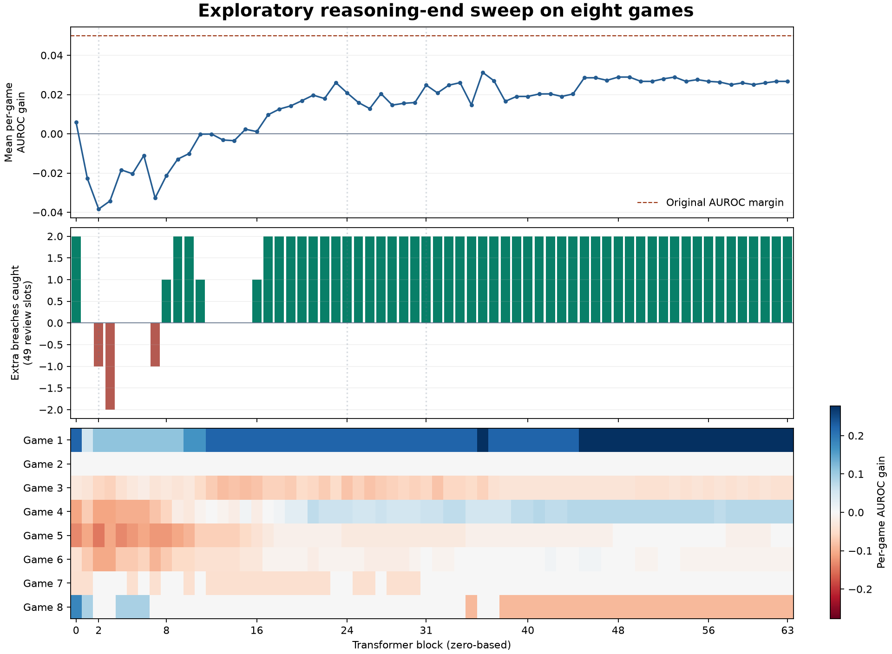

# Exploratory reasoning-end sweep on eight games

**Block 36 gave the largest ranking gain, +0.031 AUROC. No block reached the original +0.050 margin.** At the same review budget, the most any block added was two catches. Every block from 17 through 63 added exactly two, one each in the same two games. The [frozen block 31 verdict](../eight-game-reasoning-end/README.md) remains fail.



## Comparison

Each fit added one zero-based block's reasoning-end residual to the original board, text, and chain-of-thought monitor baseline. Training used the original 90 cases from four development games. Evaluation used the same 185 commitments and 23 breaches across eight games and the same 49 review slots. The baseline and blocks 2, 24, and 31 reproduced every saved case score exactly. The sweep used existing captures and the fixed model settings.

| Block | Mean per-game AUROC gain | Extra catches | Games with better AUROC |
| --- | ---: | ---: | ---: |
| 2, earlier reference | −0.038 | −1 | 1 of 8 |
| 24, secondary reference | +0.021 | +2 | 2 of 8 |
| 31, frozen primary | +0.025 | +2 | 2 of 8 |
| 36, largest observed gain | +0.031 | +2 | 2 of 8 |

At block 36, AUROC improved in two games, fell in two, and tied in four. The larger improvement came in a game with one breach. Leaving that game out of the average puts the gain at −0.004. The 47 consecutive blocks with the same catch gains indicate that the added catches were stable across depth and concentrated in two games. Block 36 gained about 0.006 AUROC over block 31 and caught the same number of breaches.

This sweep is descriptive because it ranks blocks using the eight evaluation games. Any layer selected here would need fresh games for confirmation. [score.json](score.json) contains the aggregate metrics for each block and each anonymous game, plus the checksum of the original score.

```sh
OPENBLAS_NUM_THREADS=1 VECLIB_MAXIMUM_THREADS=1 OMP_NUM_THREADS=1 \
  .venv/bin/python -m analysis.sweep_eight_game_blocks score \
  --run-root "$HOME/tara-runs" --out /path/to/new-score.json
# Use an environment with NumPy and Matplotlib for plotting.
python -m analysis.sweep_eight_game_blocks plot \
  --score /path/to/new-score.json --out /path/to/reasoning-end.png
```
